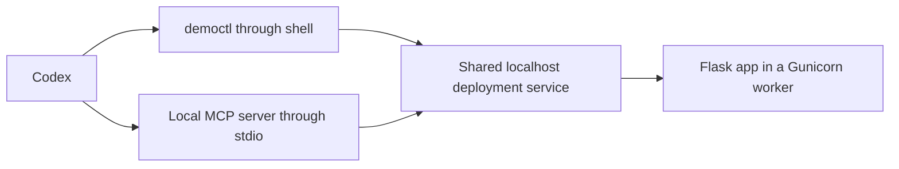

# If agents can use CLIs, what does MCP add?

A local experiment comparing the same Codex agent using a CLI, an MCP server,
and a CLI with `AGENTS.md`. Both adapters control the same local deployment
service. The service launches a real Flask/Gunicorn process and exposes its
status and runtime logs.

**No PipeOps account, hosted project, cloud server or deployment is required.**
The app and tools run locally. Codex still connects to OpenAI for model inference.

Read the [article](ARTICLE.md) and [captured comparison](local/results/RESULTS.md).
All three reported runs completed the task with four deployment-service requests
each. The earlier calibration series is retained under `local/pilot-results/`.

## Reproduce

Prerequisites: macOS or Linux, Python 3 with `venv`, Node.js 22+, npm, and an
authenticated Codex CLI. The captured case study uses Codex
`0.166.0-alpha.5.1`, model `gpt-6.1-sol`, and high reasoning effort. Use a model
available to your account and keep it fixed across your own series.

```bash
./local/setup.sh
npm test --prefix local

export MODEL=gpt-6.1-sol
export EFFORT=high
node local/run.mjs A   # CLI only
node local/run.mjs C   # CLI plus AGENTS.md
node local/run.mjs B   # MCP only
```

If Codex is not on PATH, set `CODEX_BIN` to its absolute executable path first.
The runner copies the file login from `~/.codex/auth.json` into private runtime
folders outside the repository. Set `CODEX_AUTH_SOURCE` if yours is elsewhere.
For keychain-only authentication, log in to a dedicated file-auth Codex home and
point `CODEX_AUTH_SOURCE` to its `auth.json`. Never commit credentials.

Read [the protocol](local/PROTOCOL.md) before changing settings or collecting new
runs. The first invocation freezes model, effort, versions and source hashes in
`~/mcp-vs-cli-local-exp-v2/controls.json`. Each run has fresh context and a fresh
backend. Use a new `LAB_ROOT` directory for a new series. Run conditions one at
a time and do not coach the agent. Results are saved under `local/results/`.

## What the agent does

The identical [prompt](local/prompt.txt) asks it to find `mcp-cli-demo`, deploy it,
check whether it succeeded, inspect runtime logs and report errors. The app logs
a missing `DEMO_GREETING` variable at startup and uses a fallback greeting. Its
`/health` endpoint remains healthy. The agent must distinguish an application
error log from deployment failure.



Both adapters expose four matching operations and return JSON. The CLI also
accepts `--json`; JSON is already its default. Run C receives the exact
[CLI reference](local/AGENTS.cli.md), prepared before collecting A. Run B receives
four MCP tool definitions with argument schemas. Its CLI is absent from PATH.
This controls interface availability and normal context loading, not arbitrary
host reads. The protocol requires checking traces for deviations.

## Files

| Path | Purpose |
|---|---|
| `app.py`, `requirements.txt`, `Dockerfile` | Demo app and optional container definition |
| `local/backend.mjs` | Shared deployment service; starts real app processes |
| `local/cli.mjs` | CLI adapter and its help |
| `local/server.mjs` | MCP adapter using the official SDK |
| `local/client.mjs` | Shared HTTP request function |
| `local/run.mjs` | Fresh context, fixed controls, traces and process cleanup |
| `local/test.mjs` | Integration checks through both adapters |
| `local/count_actions.py` | Trace extraction with incomplete/error handling |
| `local/results/` | Captured model traces, audits, reports and measurements |
| `ARTICLE.md` | Article based on the captured runs |

One shell execution can contain several commands and requests. Compare the
backend audit as well as visible Codex actions. Input-token totals include cached
input; do not add cached tokens to them. A lack of visible MCP discovery commands
does not establish zero schema/context cost.

This is an authored, four-operation lab with one trial per condition. It does not
measure production PipeOps behavior or establish a general performance ranking.
